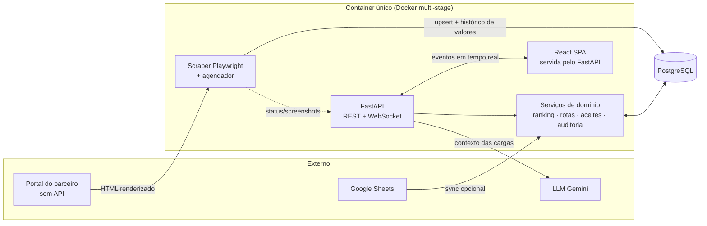

# 🍺 Scrapper Cervejaria

> Plataforma full stack que **captura cargas de um portal de parceiro sem API**, cruza com a disponibilidade de motoristas e entrega dashboards, rankings e um assistente de IA para a operação logística.

> [!NOTE]
> **Versão de portfólio.** Este sistema foi desenvolvido sob medida para **uma cervejaria específica, cujo nome não é divulgado** por confidencialidade. Nomes de empresas, credenciais, usuários, URLs, plantas, rotas e dados reais foram removidos ou trocados por valores fictícios (`CARGO`, `Portal`, `Carga Prioritária`, `example.com`). O repositório existe apenas para demonstrar arquitetura e habilidades técnicas. Não tem vínculo público com nenhuma empresa e não contém dados operacionais.


---

## 🎯 O problema

Uma transportadora precisa acompanhar, em tempo quase real, as cargas publicadas por um portal de parceiro que **não oferece API**. Além de listar, ela quer saber:

- quais cargas **surgem, mudam de valor ou somem** e por quê;
- quais **rotas** compensam e como o valor evolui ao longo do tempo;
- **quem aceita** cada carga (ranking de aceites);
- como **cruzar** motoristas disponíveis com as melhores cargas.

## 🧩 A solução

Um robô (Playwright) lê o portal em ciclos, normaliza e persiste o histórico em PostgreSQL. Uma API FastAPI expõe os dados e transmite eventos por WebSocket para um painel React com KPIs, gráficos, auditoria e um assistente de IA.

## 🏗️ Arquitetura



### Camadas do backend (`backend/app`)

| Camada | Pasta | Responsabilidade |
|---|---|---|
| **API** | `api/` | Routers FastAPI (REST + WebSocket), validação com Pydantic, autenticação e rate limit |
| **Serviços** | `services/` | Regras de negócio: scraper, ranking, rotas acompanhadas, aceites, auditoria, IA, histórico de valores |
| **Modelos** | `models/` | Entidades SQLAlchemy (cargas, aceites, rankings, histórico de valores, auditoria, usuários) |
| **Schemas** | `schemas/` | Contratos de entrada/saída (Pydantic) |
| **Infra** | `config.py`, `database.py`, `rate_limit.py` | Configuração por ambiente, engine async, limites de requisição |

### Frontend (`frontend/src`)

React 19 + Vite, estado global com Zustand, gráficos com Recharts e cliente HTTP/WebSocket dedicado.

- `pages/`: dashboard de cargas, estatísticas, relatórios, auditoria, assistente de IA, login
- `components/`: KPIs, tabela, filtros, ranking de aceites, monitor ao vivo, chat, modal de LGPD
- `store/`, `api/`, `hooks/`: estado, clientes e hook de WebSocket

## ✨ Destaques técnicos

- **Scraping resiliente** (`scraper_portal.py`): Playwright headless com `playwright_stealth`, pausas aleatórias, leitura rápida de cards já conhecidos, rolagem por mouse para listas virtualizadas e screenshots reduzidos. Há um controle de estado compartilhado (`scraper_state.py`) com cancelamento cooperativo, e relatórios têm prioridade sobre o ciclo normal.
- **Somente leitura por desenho**: o robô nunca aceita nem altera nada no portal. Essa regra está registrada no ADR em `docs/adr/`.
- **Histórico de valores** (`valor_historico.py`): cada variação de preço de uma carga vira um registro, o que permite análise de tendência por rota.
- **Casamento de rotas tolerante**: `rotas_acompanhadas.py` e `route_names.py` normalizam códigos e nomes (acentos, prefixos, variações) e, quando o identificador da carga falha, cruzam por origem/destino, com CSV de diagnóstico das não casadas.
- **Ranking de aceites** (`ranking_service.py`): consolida quem aceitou o quê, com chave de rota canônica.
- **Tempo real**: WebSocket para status do robô e novas cargas, sem polling no frontend.
- **Assistente de IA**: monta contexto a partir das cargas e do período real dos dados e consulta um LLM, citando o intervalo analisado para evitar respostas fora de contexto.
- **Auditoria completa**: toda ação relevante fica registrada e consultável em painel dedicado.
- **Segurança e LGPD**: JWT com refresh em cookie, rate limit global e mais estrito no login (SlowAPI), CORS configurável, modal de consentimento, nenhuma rota pública de manutenção de banco.
- **Migrações no startup**: ajustes de schema idempotentes no `lifespan` (decisão documentada em ADR), sem endpoints administrativos expostos.
- **Deploy simples**: `Dockerfile` multi-stage compila o React e embute o resultado no FastAPI. API, interface e robô rodam em um único serviço. Também há `docker-compose` (dev e produção local) e `render.yaml`.

## 🛠️ Stack

| Área | Tecnologias |
|---|---|
| Backend | Python 3.11, FastAPI, SQLAlchemy 2 (async), asyncpg, Pydantic, APScheduler, SlowAPI |
| Scraping | Playwright, playwright-stealth |
| Frontend | React 19, Vite, Zustand, Recharts, Axios |
| Dados | PostgreSQL |
| Infra | Docker (multi-stage), Docker Compose, Render/Railway |
| IA | Google Gemini (opcional) |

## 📁 Estrutura

```
.
├── backend/
│   ├── app/
│   │   ├── api/          # routers REST/WebSocket
│   │   ├── models/       # entidades SQLAlchemy
│   │   ├── schemas/      # contratos Pydantic
│   │   ├── services/     # regras de negócio e scrapers
│   │   ├── data/         # CSV de exemplo (rotas)
│   │   └── main.py       # app + lifespan (migrações, scheduler)
│   ├── scripts/          # utilitários e testes manuais
│   └── requirements.txt
├── frontend/             # React + Vite
├── docs/adr/             # decisões arquiteturais
├── Dockerfile            # build multi-stage
└── docker-compose*.yml
```

## ⚙️ Como rodar

Pré-requisitos: Node 20+, Python 3.11+, Docker (para o PostgreSQL).

```bash
# 1. Banco
docker compose up -d

# 2. Backend
cd backend
python -m venv venv && source venv/bin/activate   # Windows: venv\Scripts\activate
pip install -r requirements.txt
playwright install chromium
export DATABASE_URL=...  SECRET_KEY=...  ADMIN_PASSWORD=...   # veja app/config.py
uvicorn app.main:app --reload

# 3. Frontend
cd ../frontend
npm install
npm run dev
```

A interface fica em `http://localhost:5173` e a API em `http://localhost:8000` (docs interativas em `/docs`). O scraper só inicia se `PORTAL_SCRAPER_ENABLED`, `PORTAL_USER` e `PORTAL_PASS` estiverem definidos. Sem eles, a API funciona normalmente.

> Os valores padrão em `config.py` e no `docker-compose.yml` (`change_me`) são apenas para desenvolvimento. Defina sempre valores próprios em qualquer ambiente real.

## 📚 Decisões de arquitetura

As escolhas e justificativas (stack, estratégia de captura, topologia de deploy, segurança) estão em [`docs/adr/0001-decisoes-arquiteturais.md`](docs/adr/0001-decisoes-arquiteturais.md).

## 👤 Autor

**João Vitor**. Projeto desenvolvido como estudo e demonstração de engenharia de software: backend assíncrono, scraping, tempo real, dados e interface.
